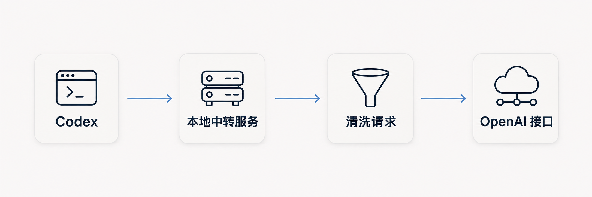

# Codex-free-api-quota

<h4 align="center">
    本项目为 Codex 提供本地 OpenAI 兼容接口，使用你订阅套餐赠送的免费 API 额度发起请求，清理已知的客户端归因信息后转发本地请求
</h4>

<p align="center">
  <a href="README.md">简体中文</a> •
  <a href="README_EN.md">English</a> 
</p>

## 工作原理


## 部署

需要 Node.js **24.5.0+**、可用的 OpenAI 官方 API key，以及已加入 PATH 的 Codex CLI

编辑 `.env` ，填入你的官方 key：

```dotenv
OPENAI_API_KEY=replace-with-your-official-key
LOCAL_API_KEY=
```

- `OPENAI_API_KEY` 必填且只供服务端使用
- `LOCAL_API_KEY` 默认留空，需要本地鉴权时填写自己选定的固定 key，也可通过启动进程的环境变量提供配置，环境变量优先于 `.env`。

在项目目录启动：

```sh
node relay.mjs start
node relay.mjs status
node relay.mjs stop

node relay.mjs start --foreground   # 前台启动
```

- 默认后台运行，启动后可查看 Base URL、模型目录 URL、鉴权模式和 provider 配置文件，设置本地 key 时才显示本地 key
- 默认地址为 `http://127.0.0.1:8787/v1`，可通过 `HOST` 指定本机 IP、主机名或所有网卡。

## 手动配置 Codex

编辑Codex配置文件 `~/.codex/config.toml`

```toml
model_provider = "Codex-free-api-quota"

[model_providers.Codex-free-api-quota]
name = "Codex-free-api-quota"
base_url = "http://127.0.0.1:8787/v1"
model_catalog_url = "http://127.0.0.1:8787/codex/models"
wire_api = "responses"
supports_websockets = false
requires_openai_auth = false
experimental_bearer_token = "local-no-auth"
```

- `LOCAL_API_KEY` 留空时，模型接口和模型目录无需鉴权，普通 HTTP 请求可不带 Authorization
- 上面的 `local-no-auth` 是公开的 Codex 兼容占位值，用于启用动态模型目录发现，并非服务访问密钥
- 若设置了 `LOCAL_API_KEY`，将 token 改为相同的本地 key

## 代理配置

- 需要代理时，在 `.env` 中显式配置 `HTTPS_PROXY`，并设置 `NO_PROXY=127.0.0.1,localhost,::1`

## License

作者：**tdragon6** · [MIT License](LICENSE)
