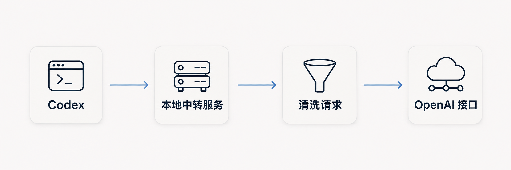

# Codex-free-api-quota

<h4 align="center">
    This project provides a local OpenAI-compatible endpoint for Codex. It uses the complimentary API credits included with your subscription and removes known client attribution information before forwarding local requests.
</h4>

<p align="center">
  <a href="README.md">Simplified Chinese</a> &bull;
  <a href="README_EN.md">English</a>
</p>

## How It Works



## Deployment

Requires Node.js **24.5.0 or later**, a valid OpenAI API key, and the Codex CLI available on your `PATH`.

Edit `.env` and enter your OpenAI API key:

```dotenv
OPENAI_API_KEY=replace-with-your-official-key
LOCAL_API_KEY=
```

- `OPENAI_API_KEY` is required and is used only by the server.
- Leave `LOCAL_API_KEY` blank to disable local authentication. To enable it, set a fixed key of your choosing. You can also supply configuration through environment variables, which take precedence over `.env`.

Run these commands from the project directory:

```sh
node relay.mjs start
node relay.mjs status
node relay.mjs stop

node relay.mjs start --foreground   # Run in the foreground
```

- The service runs in the background by default. After startup, you can view the base URL, model catalog URL, authentication mode, and provider configuration file. The local key is displayed only when one is configured.
- The default endpoint is `http://127.0.0.1:8787/v1`. Use `HOST` to bind to a local IP address, a hostname, or all network interfaces.

## Manual Codex Configuration

Edit the Codex configuration file at `~/.codex/config.toml`:

```toml
model_provider = "Codex-free-api-quota"

[model_providers.Codex-free-api-quota]
name = "Codex-free-api-quota"
base_url = "http://127.0.0.1:8787/v1"
model_catalog_url = "http://127.0.0.1:8787/codex/models"
wire_api = "responses"
supports_websockets = false
requires_openai_auth = false
experimental_bearer_token = "local-no-auth"
```

- When `LOCAL_API_KEY` is blank, the model endpoints and model catalog do not require authentication. HTTP requests can omit the `Authorization` header.
- The public `local-no-auth` value above is a Codex compatibility placeholder that enables dynamic model discovery. It is not an access key for the service.
- If you set `LOCAL_API_KEY`, replace the token with that same local key.

## Proxy Configuration

- If you need an outbound proxy, explicitly set `HTTPS_PROXY` in `.env` and set `NO_PROXY=127.0.0.1,localhost,::1`.

## License

Author: **tdragon6** &middot; [MIT License](LICENSE)
